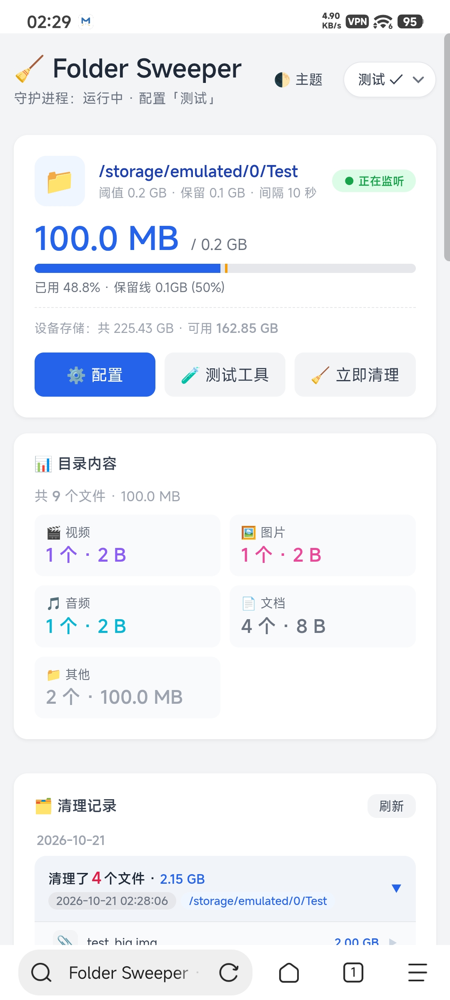

# 文件夹自动清理 (Folder Auto Cleaner) — Magisk 模块

监听指定文件夹，当总大小超过阈值时，自动按「文件修改时间从旧到新」删除最旧的普通文件，直到目录大小回落到阈值以下。内置中文 Web UI，可图形化选择监听目录、设置阈值与间隔、实时查看占用、清理记录与运行日志。

## 功能

- **后台守护进程**：开机自启，按固定间隔检测目录大小。
- **智能清理**：只删普通文件，不动目录结构；按 mtime 从旧到新删，直到 ≤ 阈值。
- **系统路径保护**：自动拒绝清理 `/system`、`/data/adb`、`/sdcard/Android` 等关键位置，即使误填也不会误伤系统。
- **Web UI**（默认 `http://手机IP:8899`）：
  - 顶部突出显示当前监听目录与占用进度条（超阈值变红）
  - 图形化「浏览」选择文件夹，不用手输路径
  - 阈值以 **GB** 为单位，默认 50 GB
  - 一键手动清理
  - 独立「清理记录」弹窗：列出每次删除的文件和释放空间
  - 运行日志实时滚动
  - 响应式布局，手机浏览器也好用
- **配置持久化**：保存在 `/data/adb/folder-cleaner/config.conf`，模块升级/重装不丢失。
- **零预置配置 + 首登引导**：模块不带任何预设配置；第一次打开 Web UI 时自动弹出配置页，引导你新建第一个配置，未建配置前守护进程不清理任何目录。
- **自动探测** Magisk / KernelSU 的 busybox，不依赖额外安装（Web UI 不再写死 KernelSU 路径）。

## 安装

1. 把 `FolderCleaner.zip` 传到手机。
2. 在 Magisk / KernelSU Manager 里「从本地安装」选择该 zip。
3. 重启手机。

> 升级旧版本时，已存在的配置会原样保留（守护进程会把旧版 `default` 配置自动迁移为 `默认`）。若想从零开始，可删除配置：`rm -f /data/adb/folder-cleaner/profiles.conf`，重启后即回到首登引导。

## 使用

1. 手机和电脑连同一 Wi-Fi。
2. 查看手机 IP（设置 → 关于手机 → 状态信息，或 `ip addr`）。
3. 浏览器打开 `http://<手机IP>:8899`。
4. 首次访问会自动弹出「新建配置」：
   - 输入配置名称（如「默认」）
   - 点「浏览」图形化选择要监听的文件夹（不再有预置的 `/sdcard/Test`）
   - 设置清理阈值（GB）、检查间隔（秒）、Web 端口
   - 点「保存配置」，该配置即被激活并开始监听
5. 之后在页面上：
   - 顶部下拉框可切换已建配置、点「➕ 添加新配置」继续新建
   - 需要立刻清理时点「立即清理一次」
   - 点「清理记录」查看历史删除明细

## 文件结构

```
FolderCleaner/
├── module.prop              # 模块信息（中文）
├── customize.sh             # 安装脚本
├── service.sh               # 开机启动入口
├── cleaner-daemon.sh        # 守护进程 + Web 服务
└── webui/
    ├── index.html           # 中文 Web 管理界面（响应式）
    └── cgi-bin/
        └── api.cgi          # 后端接口：status/save/clean/log/cleanup/browse
```

## 数据文件（都在 /data/adb/folder-cleaner/）

| 文件 | 用途 |
|---|---|
| `config.conf` | 当前激活的配置名、Web 端口 |
| `profiles.conf` | 所有配置：监听路径、阈值(GB)、间隔、保留值 |
| `cleaner.log` | 运行日志（最近 500 行） |
| `cleanup.log` | 清理记录：每次删除的文件和释放空间 |
| `daemon.pid` | 守护进程 PID，防重复启动 |

## 安全提示

Web UI 监听 `0.0.0.0`，同一局域网内任何人都能打开。用完建议改到非公开端口，或在 Magisk 里停用模块。

## 常见问题

- **为什么打开页面是空的、让我新建配置？** 这是预期行为——模块不预置任何配置，首次进入会引导你新建；未建配置前守护进程不会清理任何目录。
- **Web 打不开？** adb 执行 `cat /data/adb/folder-cleaner/cleaner.log` 看错误。
- **改了端口没生效？** 守护进程检测到 config 变化会自动重启 httpd，最多等一个轮询周期。
- **清理记录为空？** 说明还没触发过自动清理，或清理时目录本身没超阈值。
